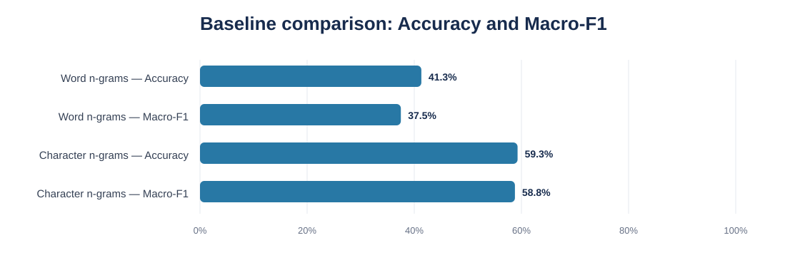
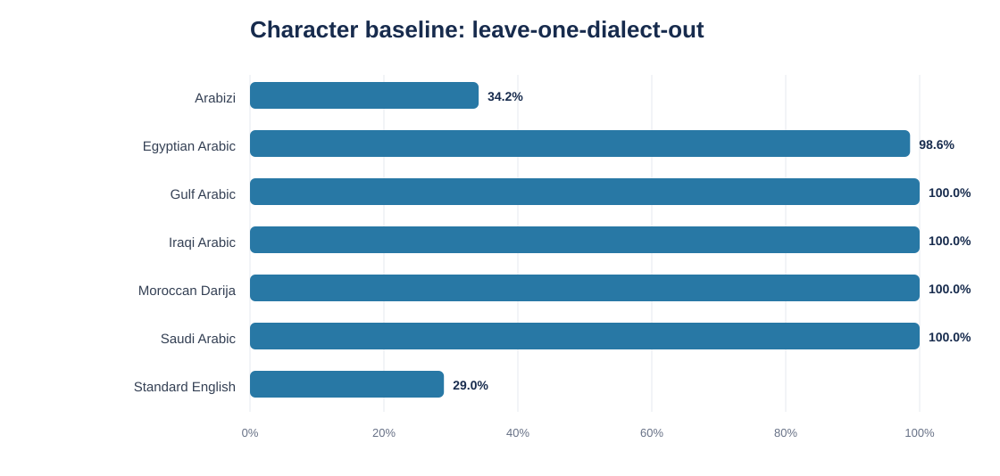

# Sada Reviews

**Arabic App Review Intelligence** — a reproducible prototype for classifying app feedback across Arabic dialects, English, and Arabizi.

## Live demo
[Open Sada Reviews](https://sadareviews-bf7mf4garfcpokblab5qhl.streamlit.app/)

## Key charts

The remaining class balance, slice scores, and confusion matrix are in the [full experiment report](reports/experiment_report.md).

## Project question
Can character-level features and a fine-tuned Arabic Transformer help product teams organize short, noisy app reviews into actionable issue themes?

## What the prototype does
- Classifies reviews into seven themes: login, crashes, performance, payments, usability, feature requests, and positive experiences.
- Uses **CAMeLBERT-Mix fine-tuned for this task as the primary model**. The app loads a local checkpoint when available; otherwise it downloads `Basmuta/sada-camelbert-reviews` from Hugging Face.
- Accepts a single review or a CSV with a review column, then visualizes category counts and dialect/language slices.
- Includes word and character Naive Bayes as lightweight research baselines only.

## Fine-tune CAMeLBERT in Google Colab
1. Open notebooks/camelbert_finetuning.ipynb in Colab.
2. Choose **Runtime → Change runtime type → T4 GPU** if available.
3. Upload data/sample_reviews.csv when prompted, then run all cells.
4. Review the per-class metrics, dialect table, confusion matrix, and saved evaluation image.
5. Download sada_camelbert_finetuned.zip and extract it into models/ next to app.py.
6. Install the app dependencies and start Streamlit:

       pip install -r requirements.txt
       streamlit run app.py

The baseline numbers below are not CAMeLBERT results. The deployed app needs the Hugging Face model repository to be public so it can download the checkpoint without credentials. Add the measured CAMeLBERT Accuracy, Macro-F1, dialect table, and confusion matrix after training when presenting model performance.

## Run the local demo on Windows
1. Download the repository using **Code → Download ZIP**, then extract it.
2. Install Python 3.11 through 3.15 and keep an internet connection for the first setup.
3. Double-click `run_demo.bat`. It creates a project environment, installs the requirements, and opens the dashboard at `http://localhost:8501`.
4. For review classification, make the fine-tuned model available in the public Hugging Face repository `Basmuta/sada-camelbert-reviews`. The app downloads the checkpoint at startup. Alternatively, extract `sada_camelbert_finetuned.zip` into `models/` for local use.

The launcher runs on the same computer. It does not publish a public web link. If the Hugging Face repository is unavailable, the sample dashboard opens but the classifier stays disabled.

## Baseline experiment
The reproducible experiment uses **1,960 synthetic examples** balanced across seven themes and seven language/dialect slices. It compares word n-gram Multinomial Naive Bayes with character n-gram Multinomial Naive Bayes.

| Baseline | Accuracy | Macro-F1 |
|---|---:|---:|
| Word n-grams | 0.413 | 0.375 |
| Character n-grams | 0.593 | 0.588 |

Character n-grams score higher on this controlled paraphrase split. This is a baseline finding on generated data, not evidence of real-world performance. See [the experiment report](reports/experiment_report.md) for test design, dialect slices, limitations, and next steps.

## Reproduce the baseline

    python experiment.py
    python build_report.py

## Data and responsible use
The sample corpus is synthetic and manually seeded. It contains no real user reviews and must not be described as collected customer feedback. CAMeLBERT is Arabic-pretrained; English and Arabizi scores should be interpreted as separate stress tests, not assumed equivalent to Arabic performance. Before making product claims, replace the sample with an appropriately licensed, de-identified dataset and manually review the labels.

## Repository map
- notebooks/camelbert_finetuning.ipynb — Colab fine-tuning and Transformer evaluation.
- app.py — Streamlit inference dashboard; loads the local or Hugging Face fine-tuned checkpoint.
- experiment.py — reproducible baseline and dialect stress tests.
- reports/ — measured baseline report and SVG charts.
- data/sample_reviews.csv — synthetic, balanced example corpus.

