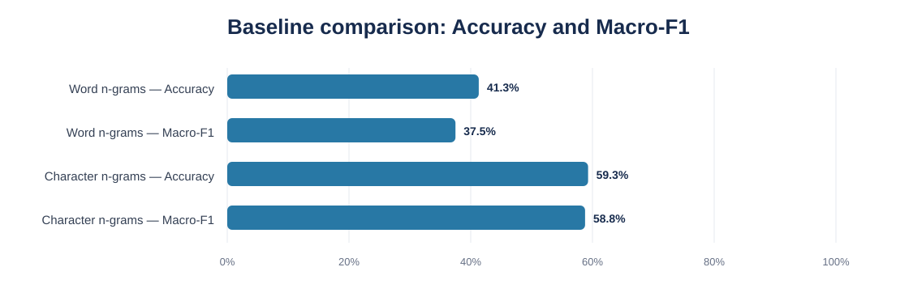
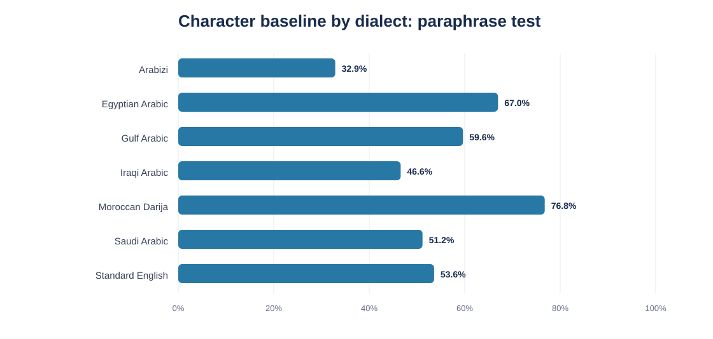
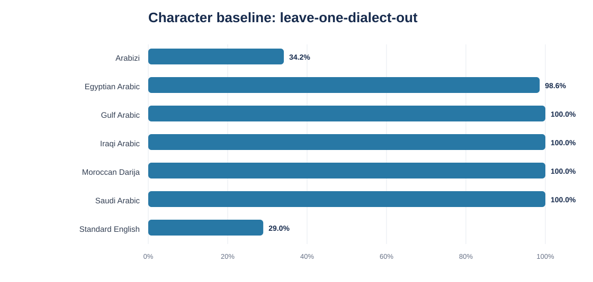
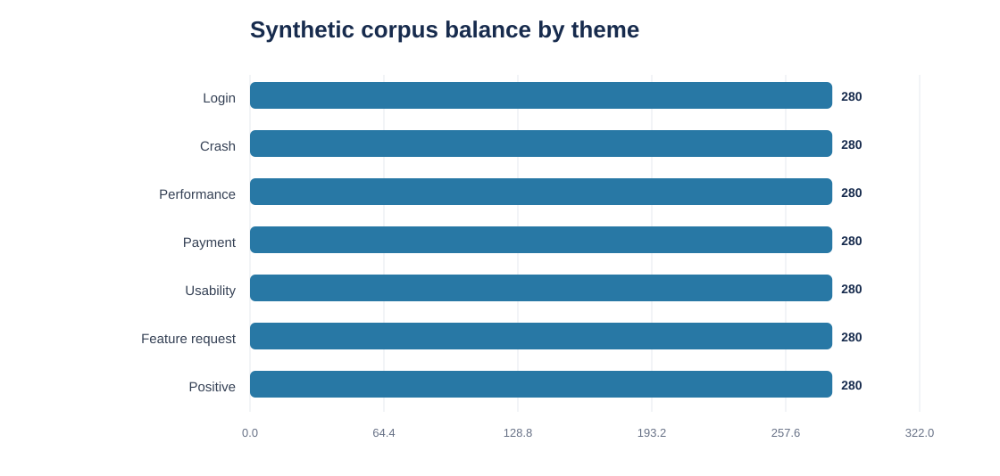
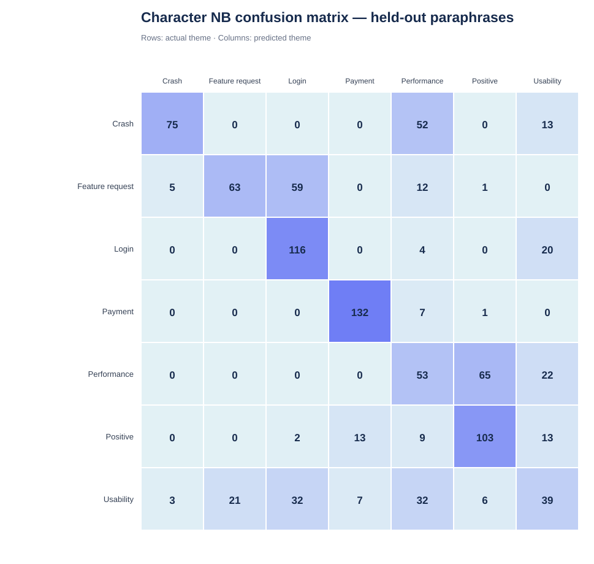

# Sada Reviews — Experiment Report

## Executive summary
We generated **1,960 synthetic reviews** balanced across seven themes and seven language/dialect slices. Character n-gram Naive Bayes reached Macro-F1 **0.588** vs **0.375** for word n-grams on the held-out paraphrase test (difference +0.213). These are baseline results on generated data, not CAMeLBERT results or real-world performance.

## Research question
Do character n-grams handle spelling and dialect variation better than word n-grams for short app reviews?

## Dataset and evaluation design
- Total: 1,960; train: 980; test: 980.
- Seven balanced themes and seven slices: Saudi Arabic, Egyptian Arabic, Moroccan Darija, Gulf Arabic, Iraqi Arabic, Standard English, and Arabizi.
- The held-out paraphrase split reserves a separately written phrase for each theme and slice. It is controlled and synthetic; wrappers/templates and category wording remain limited.
- A separate leave-one-dialect-out stress test trains on six slices and evaluates the seventh.

## Baseline comparison
| Model | Accuracy | Macro-F1 |
|---|---:|---:|
| Word unigram + bigram Multinomial NB | 0.413 | 0.375 |
| Character 2–4-gram Multinomial NB | 0.593 | 0.588 |

## Held-out paraphrase results by slice
| Slice | Macro-F1 |
|---|---:|
| Arabizi | 0.329 |
| Egyptian Arabic | 0.670 |
| Gulf Arabic | 0.596 |
| Iraqi Arabic | 0.466 |
| Moroccan Darija | 0.768 |
| Saudi Arabic | 0.512 |
| Standard English | 0.536 |

## Leave-one-dialect-out stress test
Each run excludes one complete dialect/language slice from training. English and Arabizi are lexically different from Arabic-script dialects, so transfer is expected to be harder.

| Held-out slice | Word Macro-F1 | Character Macro-F1 |
|---|---:|---:|
| Arabizi | 0.250 | 0.342 |
| Egyptian Arabic | 0.986 | 0.986 |
| Gulf Arabic | 0.922 | 1.000 |
| Iraqi Arabic | 1.000 | 1.000 |
| Moroccan Darija | 0.924 | 1.000 |
| Saudi Arabic | 1.000 | 1.000 |
| Standard English | 0.282 | 0.290 |

## Corpus balance and errors

## Interpretation
- Character features outperform word n-grams on the controlled paraphrase split, suggesting spelling-fragment features help in this setting.
- Arabizi and English remain difficult when the entire slice is withheld. This is a data coverage issue, not evidence of broad multilingual capability.
- High scores on some Arabic dialect holdouts are partly explained by shared vocabulary in the synthetic corpus.

## CAMeLBERT fine-tuning
CAMeLBERT-Mix is the intended primary app model. The Colab notebook fine-tunes it on the project categories and reports Accuracy, Macro-F1, per-class scores, dialect slices, and a confusion matrix. That training has not yet been run; therefore this report contains no CAMeLBERT scores.

## Limitations and next experiments
1. Replace generated examples with a properly licensed dataset of real app reviews; document its source and date.
2. De-identify reviews and have human annotators apply a written label guide.
3. Split by app/source and duplicate cluster to test transfer without leakage.
4. Run the CAMeLBERT notebook in Colab with a GPU; compare it against these baselines on the same fixed split.
5. Report per-dialect metrics and inspect false positives before making performance claims.

> All reported values are measured by running the included baseline experiment on synthetic examples. They are not estimates of production performance.
